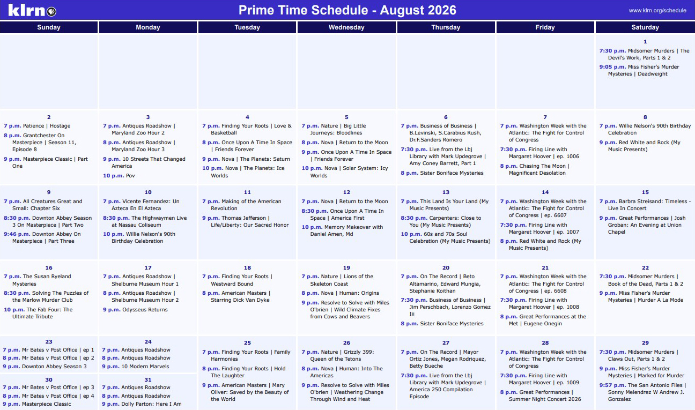

# KLRN Calendar

**Version 1.1.0**

A browser-based tool for creating, maintaining and printing KLRN TV's monthly Prime Time Schedule. The application supports automatically populating scheduled shows, and making edits before printing.

Here's an [example printed schedule](<examples/output/August 2026 Schedule.pdf>).

## How it works

- Provides an editable monthly calendar designed for printing
- Automatically populates calendar entries by parsing TV schedule PDFs, using drag-and-drop or file selection
- Allows calendars to be saved locally as HTML files using the File System Access API
- Checks for application updates when creating a new calendar or importing a PDF

## Setup

Place these files in the same server directory:

- `KLRN-Prime-Time-Schedule.html` — the standalone calendar application template
- `template.php` — serves the latest application template for updates
- `lib/` — optional directory containing [PDF.js](https://github.com/mozilla/pdf.js) library files

In `KLRN-Prime-Time-Schedule.html`, configure these properties in the APP object:

- Set `templateUrl` to the URL of `template.php`:

      templateUrl: 'https://example.com/klrn-calendar/template.php',

- Set `pdfJsSrc` and `pdfJsWorkerSrc` to locations of [PDF.js](https://github.com/mozilla/pdf.js) files in `lib\` or a CDN:

      pdfJsSrc: 'https://example.com/klrn-calendar/lib/pdf.min.js',
      pdfJsWorkerSrc: 'https://example.com/klrn-calendar/lib/pdf.worker.min.js',

- Set the current application version in the HTML:

      <meta name="app-version" content="1.1.0">

When releasing an update, increment the application version in the HTML template. The application checks for updates when the user creates a new calendar or imports a PDF.

If `templateUrl` is empty or `null`, update checking is disabled.

## PDFs for program seeding

The application can automatically populate calendar entries by importing monthly KLRN 9.1 prime-time schedules downloaded from [Myer's ProTrack](https://myersinfosys.com/). The parser expects a single-month schedule in **Long Format**.

Generating a schedule from ProTrack:

1. Navigate to **Programs > Program Search Menu > Air Date Search**.
2. Set the desired dates to a single month, and times to prime time, then click **OK**.
3. Sort the results by **Channel**.
4. Select **File > Print > Long Format**.
5. Make sure the output is set to PDF, then print.

Example PDF schedule files:

- [Supported format](<examples/input/November 2026 Schedule.pdf>)
- [Invalid format](<examples/input/November 2026 Schedule INVALID FORMAT.pdf>)
